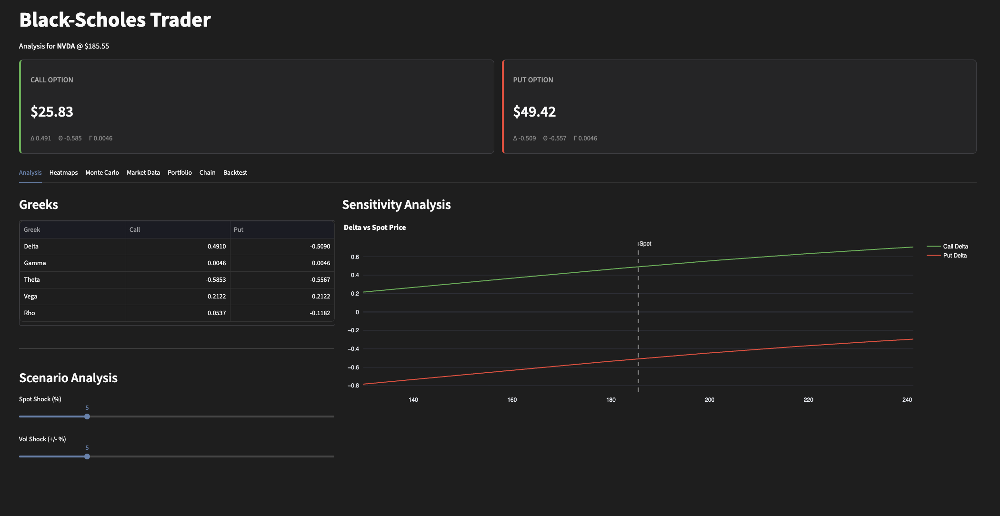

# Black-Scholes Trader

**A multi-model options pricing and analytics platform** built with FastAPI, Python, Next.js, React, and TypeScript.

Black-Scholes Trader provides a browser-based workspace for pricing options, examining option Greeks, exploring volatility, constructing multi-leg strategies, viewing market data, and running historical strategy backtests.



## Features

### Options pricing

Compare five pricing approaches:

| Model | Method | Intended use in this project |
|---|---|---|
| Black-Scholes | Closed-form analytical model | European-style option pricing |
| Binomial (American) | Cox-Ross-Rubinstein binomial tree | American-style option pricing |
| Heston MC | Monte Carlo simulation with stochastic volatility | Options under a stochastic-volatility model |
| GARCH MC | Monte Carlo simulation with GARCH(1,1) volatility | Options with time-varying volatility |
| Bates Jump-Diffusion | Monte Carlo jump-diffusion model | Options with jump risk |

### Risk and sensitivity analytics

- Calculates Delta, Gamma, Theta, Vega, and Rho.
- Uses analytical Greeks for Black-Scholes and numerical finite-difference Greeks for the other pricing models.
- Generates spot-price versus volatility heatmaps.
- Runs Monte Carlo option-price simulations.
- Displays interactive sensitivity and pricing charts.

### Volatility and market data

- Retrieves historical market-price data and option-chain data through `yfinance` (Yahoo Finance).
- Calculates historical volatility from price history.
- Builds implied-volatility surfaces from option-chain data.
- Displays market history and option-chain information for a selected ticker.

Market-data availability, coverage, and freshness depend on the upstream Yahoo Finance service. This project does not provide an exchange-grade real-time market-data feed.

### Options strategies and backtesting

- Builds multi-leg option strategies and plots payoff at expiration.
- Includes strategy templates for Straddle, Strangle, Iron Condor, Butterfly, and Collar.
- Runs historical strategy backtests using downloaded underlying-price history.
- Reports cumulative P&L, maximum drawdown, Sharpe ratio, and win rate.

**Backtesting note:** The current backtest service values option legs with the Black-Scholes model. It is a research/educational backtest, not a broker execution simulator; it does not model all trading costs, liquidity constraints, or real fills.

## Technology stack

| Layer | Technologies |
|---|---|
| Frontend | Next.js 16, React 19, TypeScript |
| UI and styling | Tailwind CSS, reusable React components |
| Charts | Plotly.js / `react-plotly.js` |
| Backend | Python 3.12, FastAPI, Pydantic, Uvicorn |
| Numerical computing | NumPy, SciPy, Pandas, Numba |
| Market data | yfinance |
| Testing | Pytest, Vitest, React Testing Library |
| CI | GitHub Actions |

## Project structure

```text
black-scholes-trader/
├── .github/
│   └── workflows/
│       └── ci.yml              # Backend and frontend CI workflow
├── api/
│   ├── app/
│   │   ├── routers/            # FastAPI route handlers
│   │   ├── schemas/            # Request and response schemas
│   │   └── services/            # Pricing, market, volatility and backtest services
│   ├── data/                   # Market-data provider implementations
│   ├── models/                 # Black-Scholes, binomial and simulation models
│   ├── strategies/             # Multi-leg strategy calculations
│   ├── tests/                  # Backend tests
│   └── requirements.txt
├── benchmarks/                 # Performance benchmark script and chart
├── docs/                       # Design notes and project plans
├── web/
│   ├── src/
│   │   ├── app/                # Next.js application pages
│   │   ├── components/         # UI, pricing, strategy and chart components
│   │   ├── hooks/              # Frontend data hooks
│   │   └── lib/                # API client and shared types
│   ├── package.json
│   └── package-lock.json
├── preview.png                 # Application screenshot
├── docker-compose.yml
├── DESIGN.md
├── CHANGELOG.md
└── README.md
```

## Getting started

### Prerequisites

- Python 3.12 (the CI workflow uses Python 3.12; the API package declares Python 3.10 or newer).
- Node.js 22 and npm.
- Git.

### 1. Clone the repository

Replace `YOUR_GITHUB_USERNAME` with the GitHub account that owns the repository.

```bash
git clone https://github.com/YOUR_GITHUB_USERNAME/black-scholes-trader.git
cd black-scholes-trader
```

### 2. Start the backend

From the repository root, run:

```powershell
cd api
py -3.12 -m venv .venv
.\.venv\Scripts\Activate.ps1
python -m pip install --upgrade pip
pip install -r requirements.txt
uvicorn app.main:app --reload
```

The API will be available at:

- API base: `http://localhost:8000`
- Interactive Swagger documentation: `http://localhost:8000/docs`
- Health check: `http://localhost:8000/api/health`

For macOS/Linux, activate the virtual environment with:

```bash
source .venv/bin/activate
```

### 3. Start the frontend

Open a second terminal from the repository root:

```powershell
cd web
npm ci
npm run dev
```

Open the application at `http://localhost:3000`.

For local development, the Next.js configuration proxies `/api/*` requests to `http://localhost:8000` by default. Start the backend before using features that make API requests.

## API endpoints

| Method | Endpoint | Description |
|---|---|---|
| `GET` | `/api/health` | API health and available models |
| `GET` | `/api/models` | Lists pricing models and their parameters |
| `POST` | `/api/price` | Prices an option using the selected model |
| `POST` | `/api/heatmap` | Generates a spot-price/volatility heatmap |
| `POST` | `/api/monte-carlo` | Runs a Monte Carlo option simulation |
| `POST` | `/api/volatility-surface` | Builds an implied-volatility surface |
| `GET` | `/api/market/{ticker}` | Retrieves market history and historical volatility |
| `GET` | `/api/chain/{ticker}` | Retrieves an options chain |
| `POST` | `/api/strategy/payoff` | Calculates a multi-leg strategy payoff |
| `POST` | `/api/backtest` | Runs a historical strategy backtest |

## Running tests and checks

### Backend

```powershell
cd api
python -m pytest tests/ -v
ruff check .
mypy . --ignore-missing-imports
```

If `ruff` or `mypy` is not installed in your environment, install the development tools before running those checks:

```powershell
pip install pytest ruff mypy
```

### Frontend

```powershell
cd web
npm ci
npm test
npm run lint
npm run build
```

The GitHub Actions workflow in `.github/workflows/ci.yml` runs backend linting, type checking and tests, and frontend build and test commands on pushes and pull requests for the configured branches.

## Docker

A `docker-compose.yml` and Dockerfiles are included. The current frontend/API URL configuration should be checked before relying on the Compose setup: the frontend's browser-side API base URL and the Next.js rewrite target use different environment-variable names, and a Docker-internal hostname is not directly resolvable by a browser on the host. The manual two-terminal setup above is the verified-by-configuration local development path; validate or correct the container networking before documenting Docker as a tested deployment path.

## Disclaimer

This software is for educational, research, and analytical purposes only. It is not investment advice and should not be used as the sole basis for financial decisions. Pricing models rely on assumptions and input data that may not reflect actual market conditions.
